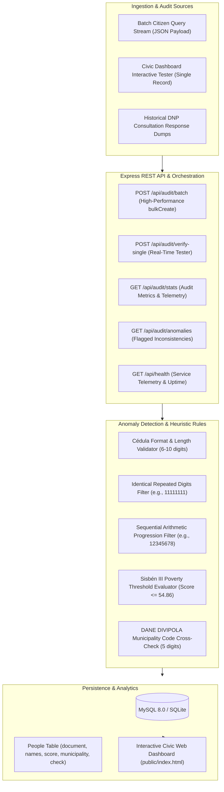
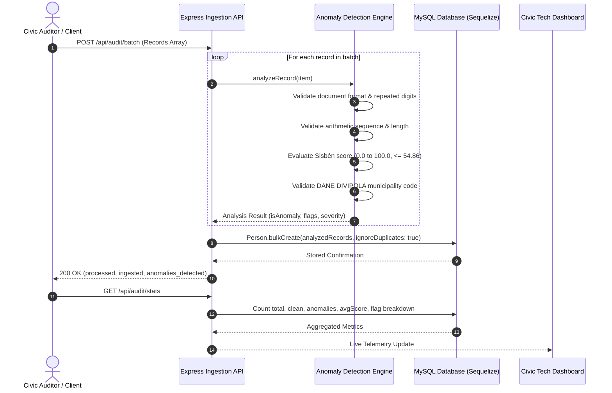

# Colombia Ingreso Solidario - Civic Data Audit & Identity Anomaly Engine

[](https://github.com/KevinAndrey96/nodejs-colombia-ingreso-solidario-audit-engine/actions/workflows/ci.yml)
[](https://nodejs.org/)
[](https://expressjs.com/)
[](https://sequelize.org/)
[](https://www.mysql.com/)
[](https://www.docker.com/)
[](https://github.com/KevinAndrey96/nodejs-colombia-ingreso-solidario-audit-engine)
[](LICENSE)

High-throughput data ingestion pipeline, identity anomaly detection engine, and civic oversight platform engineered during the **COVID-19 national emergency in Colombia (April 2020)**.

The platform was built to analyze and audit social subsidy beneficiary records from the **Departamento Nacional de Planeación (DNP)** for the **Ingreso Solidario** unconditional cash transfer program. It automatically detects ghost identity numbers (cédulas fantasma), trivial sequential patterns, out-of-range Sisbén III vulnerability scores, and invalid DANE municipal geography codes (DIVIPOLA).

---

## 🏛️ Historical Context & The April 2020 DNP Anomaly Investigation

In April 2020, at the onset of nationwide quarantine lockdowns, the Colombian National Government instituted **Ingreso Solidario** (Decree 518 of 2020) to disburse 160,000 COP monthly to 3 million vulnerable households excluded from Familias en Acción or Jóvenes en Acción.

When the government launched the official consultation portal (`ingresosolidario.dnp.gov.co`), software developers, journalists, and civic hackers identified anomalous behavior: querying non-existent or synthetic Colombian identification numbers (such as `11111111`, `22222222`, `12345678`, `00000000`, `99999999`) returned valid full names, active subsidy beneficiary statuses, and Sisbén scores.

This repository preserves the civic tech ingestion microservice and audit engine developed during that crisis to capture incoming citizen query responses, execute pattern-matching anomaly heuristics, and store structured audit trails for statistical verification.

---

## 🏗️ System Architecture



---

## 🔄 Ingestion & Audit Pipeline Sequence



---

## 🔍 Anomaly Detection Heuristics Matrix

| Heuristic Code | Detection Pattern | Severity | Example / Trigger | Civic Impact |
| :--- | :--- | :---: | :--- | :--- |
| **`REPEATED_DIGITS`** | Single identical digit repeated across entire length (`/^(\d)\1+$/`) | **HIGH** | `11111111`, `22222222`, `00000000` | Flags placeholder or synthetic identity records never issued by the civil registry (ANI). |
| **`SEQUENTIAL_DIGITS`** | Ascending or descending consecutive numbers | **HIGH** | `12345678`, `87654321`, `123456789` | Flags test fixtures or auto-increment mock records left in production databases. |
| **`INVALID_LENGTH`** | Document length outside legitimate Colombian range | **MEDIUM** | `< 6` or `> 10` digits | Violates National Civil Registry (Registraduría) standards. |
| **`NON_NUMERIC_CHARS`** | Document contains alphabetic or symbolic characters | **MEDIUM** | Letters, hyphens, or punctuation | Flags uncleaned raw OCR or form injection strings. |
| **`OUT_OF_RANGE_SISBEN`** | Sisbén score outside statistical boundary `[0.0, 100.0]` | **HIGH** | `Score < 0` or `Score > 100` (e.g. `145.0`) | Math/data corruption in poverty targeting calculations. |
| **`INELIGIBLE_SISBEN`** | Score exceeds extreme poverty / vulnerability threshold | **MEDIUM** | `Score > 54.86` (e.g. `84.5`) | Identifies recipients exceeding socioeconomic cutoff for emergency cash transfers. |
| **`INVALID_MUNICIPALITY_CODE`**| Non-compliant DANE municipal geographic code | **LOW** | Code outside `[05001, 99999]` | Geographic allocation error hindering municipal bank branch delivery. |

---

## 🚀 Quick Start with Docker Compose

The complete stack includes the Node.js API engine and a pre-seeded MySQL 8.0 container.

### 1. Clone Repository
```bash
git clone git@github.com:KevinAndrey96/nodejs-colombia-ingreso-solidario-audit-engine.git
cd nodejs-colombia-ingreso-solidario-audit-engine
```

### 2. Launch Containers
```bash
docker compose up -d --build
```

The system will start:
- **Interactive Civic Dashboard**: [http://localhost:8097](http://localhost:8097)
- **REST API Base URL**: `http://localhost:8097/api/audit`
- **MySQL Database**: `localhost:5437` (database: `cedulas_db`, user: `cedulas_user`, password: `cedulas_secure_password`)

---

## 📡 REST API Reference

### 1. Healthcheck
```bash
curl -X GET http://localhost:8097/api/health
```

### 2. Real-Time Single Identity Verification
```bash
curl -X POST http://localhost:8097/api/audit/verify-single \
  -H "Content-Type: application/json" \
  -d '{
    "document": "11111111",
    "firstName": "Pedro",
    "lastName": "Pérez",
    "score": "12.0",
    "municipality": 11001
  }'
```
**Response:**
```json
{
  "status": "success",
  "data": {
    "document": "11111111",
    "firstName": "Pedro",
    "lastName": "Pérez",
    "score": 12,
    "municipality": 11001,
    "check": "FLAGGED",
    "type": "BENEFICIARIO_COVID19",
    "isAnomaly": true,
    "severity": "HIGH",
    "flags": ["REPEATED_DIGITS"],
    "details": ["Cédula sospechosa compuesta por un solo dígito repetido (11111111)."]
  }
}
```

### 3. Batch Ingestion (High-Throughput bulkCreate)
```bash
curl -X POST http://localhost:8097/api/audit/batch \
  -H "Content-Type: application/json" \
  -d '[
    {
      "cedula": "1018475892",
      "name": "Carlos",
      "lastName": "Gómez",
      "score": "24.5",
      "municipality": 11001
    },
    {
      "cedula": "12345678",
      "name": "Secuencia",
      "lastName": "Test",
      "score": "35.4",
      "municipality": 68001
    }
  ]'
```

### 4. Audit Statistics & Telemetry
```bash
curl -X GET http://localhost:8097/api/audit/stats
```

### 5. Anomaly Records Listing
```bash
curl -X GET "http://localhost:8097/api/audit/anomalies?limit=10"
```

---

## 🧪 Automated Testing Suite

The repository includes a standalone test suite with zero external dependencies:

```bash
npm test
```

Expected output:
```text
> nodejs-colombia-ingreso-solidario-audit-engine@1.0.0 test
> node scripts/test_audit_engine.js

[*] Starting Anomaly Detection Engine Verification Tests...

[Test 1] Testing Repeated Digits Detection (Cédulas Fantasma)...
  -> Passed: Repeated digits properly identified.

[Test 2] Testing Sequential Digits Detection...
  -> Passed: Arithmetic sequences detected.

[Test 3] Testing DANE Municipality Code Validation...
  -> Passed: Municipality codes correctly verified.

[Test 4] Analyzing Legitimate Beneficiary Record...
  -> Passed: Legitimate citizen verified clean.

[Test 5] Analyzing Ghost Cédula 11111111...
  -> Passed: Ghost cédula correctly flagged with HIGH severity.

[Test 6] Analyzing Ineligible Sisbén Score (Exceeds Vulnerability Cutoff)...
  -> Passed: Ineligible Sisbén score flagged.

====================================================
[SUCCESS] All 6 Anomaly Engine tests passed flawlessly!
====================================================
```

---

## 📁 Repository Structure

```text
├── config/
│   └── config.json               # Environment-based database configuration
├── docker/
│   └── init.sql                  # Turnkey MySQL schema with 2020 scandal seed cases
├── lib/
│   └── anomalyDetector.js        # Core civic audit & pattern-matching engine
├── models/
│   ├── index.js                  # Sequelize ORM initialization & dynamic config
│   └── person.js                 # Person beneficiary data model with indexes
├── public/
│   └── index.html                # Interactive Civic Tech Audit Dashboard
├── scripts/
│   └── test_audit_engine.js      # Zero-dependency test suite
├── app.js                        # Express server entrypoint & REST API handlers
├── docker-compose.yml            # Multi-container orchestration (ports :8097, :5437)
├── Dockerfile                    # Node.js 18 production container
├── package.json                  # Dependencies & npm scripts
└── README.md
```

---

## 📄 License

This project is open-source under the [MIT License](LICENSE).
Preserved for civic accountability, open government data research, and educational analysis of public sector data pipelines.
